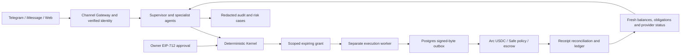

# Synq

Synq is a finance team in chat for freelancers and small businesses. Specialists assess invoices, cash and counterparty risk. A deterministic Kernel checks the evidence and the owner's signed authority. A separate executor moves test USDC, records the signed transaction before broadcast and reconciles its receipt.

This is a **preproduction testnet demonstration**. Arc testnet is chain **5042002**; cross-chain proofs also use Ethereum Sepolia. `SYNQ_ALLOW_MAINNET_BROADCAST=false`. Developer-controlled wallets play the client, contractor and owner roles. They are not independently onboarded customers.

## Architecture



Agents propose and explain. They have no unrestricted signer. A chat message, card button or “yes” is never a financial approval. Chat-originated payouts require the owner's EIP-712 signature over the exact intent.

## Proven workflows

The links below point to real testnet transactions. Local evidence JSON files are intentionally excluded from Git; their names identify the reproducible proof runs.

| Workflow                       | Proof                                                                                                                                                                                                                                                                                                                                                                                                                                                                                         | Environment                                  |
| ------------------------------ | --------------------------------------------------------------------------------------------------------------------------------------------------------------------------------------------------------------------------------------------------------------------------------------------------------------------------------------------------------------------------------------------------------------------------------------------------------------------------------------------- | -------------------------------------------- |
| Invoice collection via CCTP V2 | [Sepolia burn](https://sepolia.etherscan.io/tx/0x199e611fe4fe829d3a96658ace708cd8b83bf694f9b373b30562aa1bc7d0ee3e), [Arc mint](https://explorer.testnet.arc.io/tx/0x4f5a4f8e85f0c88c52e2608487ebfcf06bb800acce7430114865b90b1d1903d3); `cctp-0x199e611f.json`                                                                                                                                                                                                                                 | Sepolia → Arc testnet                        |
| Gateway unified balance        | [Arc destination transaction](https://explorer.testnet.arc.io/tx/0x820292371baeea42320f2c308bc3cd352ca6f1aea46e73bed7925e9bb85a4446); `gateway-0x82029237.json`                                                                                                                                                                                                                                                                                                                               | Testnets                                     |
| Revenue waterfall and restart  | [0.002 USDC leg](https://explorer.testnet.arc.io/tx/0x3c88e535d6daa8fb3744da4c4876057aaa78a6f5b3a1a98f9059df67a141f142), [0.001 USDC leg](https://explorer.testnet.arc.io/tx/0x7e6548abce2faa390fbcaa01efe92a5827cbe1ed87b130cc299be3fd69ffc93c); `revenue-split-3c88e535.json`                                                                                                                                                                                                               | Arc testnet, agent-wallet fallback           |
| Deal Room escrow               | [Fund](https://explorer.testnet.arc.io/tx/0x04649edb9bf8639be52e4cdeb12839f07e42facc5eed75cff395c9411e1c4a7d), [release](https://explorer.testnet.arc.io/tx/0x1733dc968e2b54f03932ea727e602a88046203e57f4a8e90b54d214e2e92a654), [dispute](https://explorer.testnet.arc.io/tx/0x4a478ee46a1b89e4e63bfda09c9b041fdaddcd72aae9606e364fac881ff1ffde), [refund](https://explorer.testnet.arc.io/tx/0x890b71c2c1d9d3fc1a50705f6cf245769238b220afaa12e1332adbb6af2704f4); `deal-room-04649edb.json` | Arc testnet                                  |
| CFO and Risk team              | [Owner-approved 0.001 USDC payout](https://explorer.testnet.arc.io/tx/0x2b82713f0bf0302c44ca76a045e7d50ad89c5151dd80dfc076ecd131582e3d00); `agent-team-2b82713f.json`                                                                                                                                                                                                                                                                                                                         | Arc testnet; chat transport is LOCAL_INGRESS |

The waterfall deliberately exits after recording a leg, then resumes with no new signature for that payment. Its books and the Deal Room proof reconcile exactly. The team proof uses the **same owner-approved team grant** for the wallet payout, with durable obligation, approval, budget, grant and outbox stores.

The changed-wallet attack moves no money: Risk emits HARD flags, the Kernel denies, and an independent vault `eth_call` reverts. The team proof reads the vault's remaining operator window and spends **zero vault funds**. The destination cooling default is **24 hours**. This run records an owner-signed **11-hour exception**, because the fixture's verification timestamp was not yet 24 hours old.

## Circle integrations and current limits

Merged code proves native USDC transfers, Circle CCTP V2 invoice collection, Gateway deposit/spend and governed Safe/escrow contract calls. Arc's ERC-20 USDC uses 6 decimals; native gas accounting uses 18. The native mirror Transfer log is excluded from ERC-20 payment reconciliation.

Additional Circle-workstream evidence exists for **App Kit Swap** (0.02 USDC → 0.022777 EURC), **App Kit Earn** (0.05 USDC deposit and full exit) and **Paymaster v0.8 on Sepolia** (ERC-4337 fee paid in USDC). The reviewed planners and guarded testnet scripts are merged. They are not yet autonomous checkout actions: standalone Earn deposits refuse missing imported obligations, and SDK scripts have no durable retry journal. Earn is a DeFi vault integration, not a USYC position. USYC's eligibility read returned `canCall=false`; no USYC deposit is claimed.

Circle developer wallets and Gas Station await credentials. The operational wallet here is a local testnet EOA, not a Circle Agent Wallet. Direct transfers and CCTP do not establish App Kit Send/Bridge SDK usage. Live x402, ERC-8004 identity and ERC-8183 jobs remain pending.

Reviewed commerce, travel and contributor-fund code is merged, with provider-sandbox evidence. Booking mutations require durable attempt storage; unresolved group payments keep funds reserved. A Lithic sandbox authorization is not an Amazon order. A Duffel cancellation refund receivable is not settled cash. Provider sandbox balances never fund Arc transactions.

## Setup

Use Node **22.23.1**, pnpm **10.28.2** through Corepack, and Postgres **14+**. Foundry **1.2.3** / Solidity **0.8.28** are used for contracts.

```sh
corepack pnpm install --frozen-lockfile
export SYNQ_ALLOW_MAINNET_BROADCAST=false
export SYNQ_EXECUTION_DATABASE_URL=postgresql://postgres@127.0.0.1:55433/synq_execution
export SYNQ_RISK_DATABASE_URL=postgresql://postgres@127.0.0.1:55433/synq_risk
```

Provision the local databases and testnet key files before running proofs. Scripts read keys by path under `~/.synq/`; never commit them or paste them into chat. The owner/deployer, client, contractor and operational signer are distinct test roles. Provider settings are supplied through the environment. The team demo needs `OPENAI_API_KEY` and `OPENAI_MODEL`; missing screening credentials are disclosed and never interpreted as a successful screen. Contract addresses and expected code hashes live in `sources/arc_registry.json`.

## Run the proofs

These scripts can send real **testnet** transactions and consume testnet gas. Keep amounts tiny and inspect the relevant script's flags before running. Each proof writes local JSON evidence.

```sh
# Main merged demonstrations
node --import tsx scripts/arc-deal-room-demo.ts
node --import tsx scripts/arc-revenue-split-proof.ts --mode wallet --dir /tmp/synq-split-proof --crash
# Expected deliberate crash: re-run with the same directory, without --crash.
node --import tsx scripts/arc-revenue-split-proof.ts --mode wallet --dir /tmp/synq-split-proof
node --import tsx scripts/arc-agent-team-demo.ts --amount 1000

# Existing invoice, settlement and authority proofs
node --import tsx scripts/arc-freelancer-demo.ts
node --import tsx scripts/arc-cctp-proof.ts
node --import tsx scripts/arc-gateway-proof.ts
node --import tsx scripts/arc-invoice-proof.ts
node --import tsx scripts/arc-checkout-proof.ts
node --import tsx scripts/arc-ap-proof.ts
node --import tsx scripts/arc-granted-payout.ts

# Read-only indexer and custody verification
node --import tsx scripts/arc-indexer-proof.ts
node --import tsx scripts/arc-custody-check.ts
```

The execution worker refuses a missing durable database unless explicitly run with the development-only memory-fence option. Never use that option to imply restart safety. Individual proof scripts may use additional databases; consult their environment variables. The test harness can create disposable `synq_m2_*` databases when its Postgres user has that permission.

## Verification

```sh
corepack pnpm exec tsc --noEmit
corepack pnpm exec tsc --noEmit -p apps/web/tsconfig.json
corepack pnpm exec eslint packages apps workers plugins scripts tests --no-warn-ignored
node scripts/architecture.mjs
node scripts/secrets.mjs
corepack pnpm format:check
corepack pnpm exec vitest run --exclude '**/*.integration.test.ts' --exclude 'reports/**' --maxWorkers=2
forge test --root contracts --offline
```

The integrated team gate passed **1,659 unit tests** (19 skipped). Its targeted checks passed **103 tests** (3 live-model tests skipped); the new live demo separately ran the real model and testnet payout. The most recent contract gate passed **250 tests**; W4 changed no contracts. Run database integration suites with their test-specific database URLs. The complete `test:integration` command also includes Anvil/Redis/Temporal suites and requires those services; passing local Postgres tests does not certify them.

## Security boundaries and open work

- EIP-712 approvals bind principal, intent, asset, payer, recipient, amount, nonce and deadline. The executor admits a scoped grant; the model cannot alter those fields into authority.
- Postgres unique constraints and atomic outboxes protect the tested replay/concurrency paths. Ambiguous outcomes require reconciliation before retry. Whole-operation escrow resumption after grant expiry is not automatic.
- The council proposes; custody authority remains the actual Safe configuration. A BOUND claim requires live owners, threshold, exact modules and guard checks.
- Redacted audit records form a hash chain. HMAC checkpoints need an independently retained head and stable external key to detect a database rollback across cold restarts. The team demo's external checkpoint key lasts only for that process.
- Telegram adapters and local ingress are tested. The real Telegram Guest Mode round trip is not proven, and this integrated branch is not demonstrated as deployed.
- External wallet screening is blocked. Anomaly and velocity rules were not exercised in the live team demo because no payout history or velocity policy was injected.
- Review links expose terms to their bearer. The escrow arbiter is a hot-key role. Credential-dependent, production and mainnet paths remain unproven.

No mainnet canary, public publication, push or hackathon submission is authorized by running these proofs. The remaining workstream reviews, cross-channel cards, broader security/performance coverage, pilot mapping and submission handoff are incomplete.

## External tester preparation

The checkout supports a fresh signed invoice per tester. With the same Postgres database and stable `SYNQ_PAY_LINK_KEY` as the API, run `node --import tsx scripts/arc-tester-invoice.ts --tester tester01 --base-url https://synqlabs.world --amount-base-units 1000`. It issues invoice terms and a six-hour link; it sends no transaction and does not deploy the site. Public deployment remains unapproved and unverified.

After consented testers pay from their own wallets, `node --import tsx scripts/arc-tester-tally.ts` reads matching Memo receipts and reports distinct external payer wallets separately from controlled roles. Wallet counts do not establish distinct humans, businesses or consent. The current local kit smoke paid nothing and establishes zero external traction. `node --import tsx scripts/arc-demo-preflight.ts` reads RPC health, test-wallet balances and the vault operator window without signing or broadcasting.
